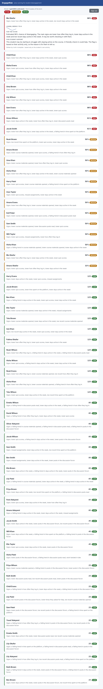
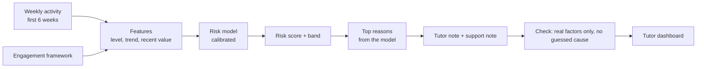
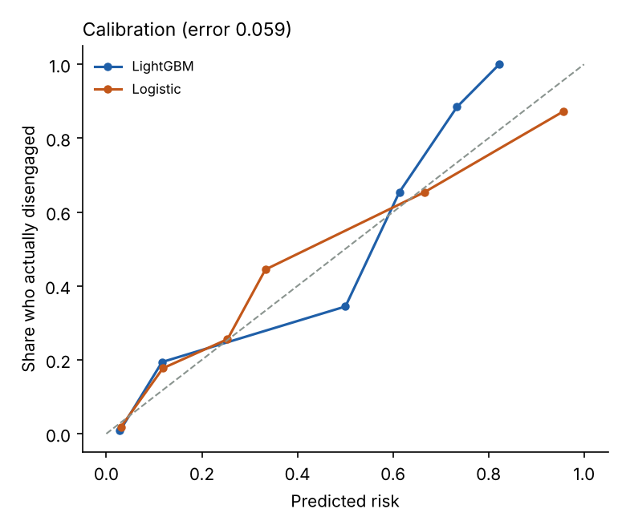
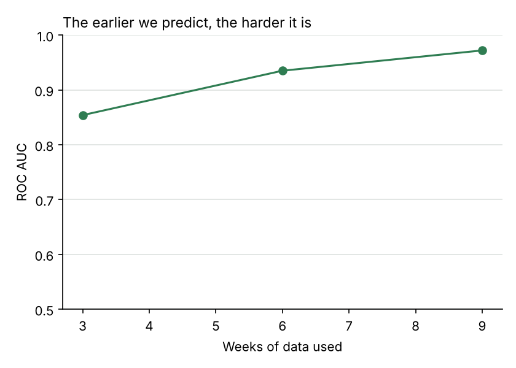

# EngageRisk

**Spot students who are starting to disengage, early in the term, and explain
each flag in plain English so staff can act on it.**

EngageRisk reads the ordinary activity a learning platform records (logins,
time on the platform, resources opened, work handed in, quiz scores, forum
activity) and, using only the first few weeks, estimates each student's risk of
having disengaged by the end of term. It gives every flag a calibrated
probability and a short, plain reason, and it is checked for fairness between
groups.



## Why this project

Universities lose students who quietly fall behind before anyone notices. The
signs are usually in the data weeks earlier: fewer logins, a falling trend in
activity, a missed assignment. The aim here is a tool a tutor can actually use:
it finds the students most at risk, says why in words, and is careful to be
fair and not to over-claim.

## From engagement research to signals

The model is grounded in how student engagement is described in research, in
three parts: behavioural (turning up and taking part), cognitive (doing the
academic work) and emotional or social (feeling connected to the course). Each
part is turned into signals the platform records (see `er/engagement.py`), so
every feature the model uses, and every reason it gives, traces back to a part
of engagement rather than being a black box.

## How it works



For each signal we use its **level** (the average), its **trend** (rising or
falling) and its **most recent value**. A falling trend is often the earliest
warning, before the average looks bad.

## Results

Trained on one cohort of 1,600 students and tested on a separate cohort of 800
the model never saw. About 24% of students disengage. Using only the **first 6
weeks**:

| Model | ROC AUC | PR AUC | Brier | Calibration error |
|---|---|---|---|---|
| **Calibrated logistic regression (deployed)** | **0.935** | **0.817** | **0.085** | **0.027** |
| LightGBM (compared) | 0.915 | 0.767 | 0.097 | 0.059 |

I compared a gradient-boosted model (LightGBM) with logistic regression. On
this data the logistic model did slightly better and is simpler and easier to
explain, so it is the one deployed. The gradient-boosted model is kept as a
check. Choosing the simpler model that does the job is the honest call.



The risk scores are calibrated, so they mean what they say: of the students
given a 70% risk, about 70% really disengage (calibration error 0.027).

### How early can it tell?

The earlier you predict, the less data you have. The model still works from
week 3, and gets stronger each week:

| Weeks of data | ROC AUC | Disengagers caught in the top 20% flagged |
|---|---|---|
| 3 weeks | 0.854 | 54% |
| 6 weeks | 0.935 | 67% |
| 9 weeks | 0.972 | 74% |



### Fairness

The model is checked on two groups with different disengagement rates (20% and
28%). It performs almost the same for both (ROC AUC 0.917 and 0.911) and flags
the same share of each group (about 20%), so it does not treat one group worse
than the other. Fairness is measured and reported, not assumed.

## Responsible use

- **It explains itself.** Every flag lists the real signals that drove it,
  taken straight from the model (`er/explain.py`), and a check makes sure the
  reasons given are the student's actual top factors.
- **It describes behaviour, not causes.** A flag says activity has dropped or
  work was missed. It never guesses why (illness, money, confidence): that is
  for a human conversation, and the notes say so.
- **Personal data is protected.** If a language model is used to write a note,
  the student's name is removed first (`er/redact.py`). By default a plain
  template writes the notes, so the tool runs offline.
- **It does not show false certainty.** The shown risk is capped, so no student
  is ever labelled 100%.

The dashboard needs a login. Passwords are stored only as a salted PBKDF2 hash,
and login returns a signed token with an expiry (`er/auth.py`).

## Run it

```bash
pip install -r requirements.txt
make data      # create the student cohorts with ground truth
make eval      # train, test, compare models, check fairness
make test      # 12 tests
make serve     # dashboard at http://127.0.0.1:8000  (sign in: tutor / engagerisk)
```

## Project layout

```
er/
  engagement.py  the engagement framework: research parts -> signals
  sim.py         simulated cohorts with weekly activity and real outcomes
  features.py    level, trend and recent value for each signal
  model.py       calibrated logistic model, LightGBM comparison, per-student reasons
  explain.py     turn the reasons into plain notes for two audiences, checked
  redact.py      remove names before any language model
  auth.py        password hashing and signed tokens
  score.py       score a cohort and explain each student
  api.py         FastAPI app
web/             the tutor dashboard
scripts/         make_data, run_eval, make_demo
tests/           12 tests
```

## Honest limits

- The students are simulated, so the scores are higher than real data would
  give. The method and the checks matter more than the exact numbers.
- Real engagement data is messier and the fairness question is harder; a real
  build would test on real cohorts and involve staff and students in the design.
- A risk flag is a prompt for a caring conversation, never a judgement about a
  student, and never an automatic decision.

Licence: MIT. Author: Jasper Chinedu Nwangere.
